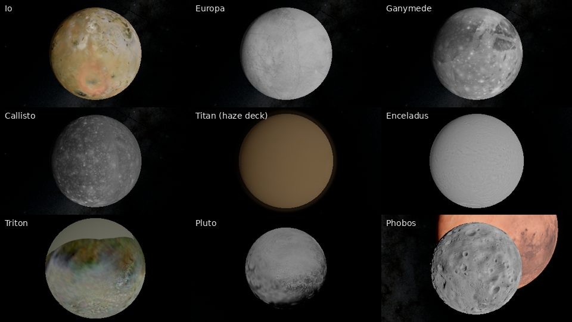

# M1 demo: Sol

**Goal (PRD 9a):** the Solar System at real positions, with real surface data where licensed: Earth and Moon with terrain from orbit to the ground, the planets and major moons, and the Sun.

**Run:** `npm run dev`, open `http://localhost:5173/?view=<name>&cockpit=0` with `leo`, `earth-sunset`, `earth-low`, `moon-orbit`, `moon-surface`, `earthrise`, `mars`, `jupiter`, `saturn`, `sun`, or `body:<NAIF id>` for any loaded body (for example `body:606` for Titan). Add `t=2026-12-25T00:00:00Z` for another date. Every capture below was rendered in Chromium (SwiftShader WebGPU) from this build.

## What is real here

| Element | Source | Label in game |
|---|---|---|
| Positions of the Sun, planets, Pluto and 11 moons, current date | JPL Horizons, fitted offline to Chebyshev segments; held-out check samples agree within 7 m for the Moon, 600 m for every moon and 1.6 km for every body (`maxHeldOutErrorMeters` in `ephemeris.json`) | Measured |
| Rotation (pole, prime meridian, spin) and radii | IAU WGCCRE 2015 via NAIF pck00011 | Measured |
| Earth imagery, night lights, clouds | NASA Blue Marble NG, Black Marble 2016, Blue Marble clouds | Measured |
| Earth elevation (4 arc-minute grid) | NOAA ETOPO 2022 | Measured |
| Moon colour and elevation | NASA SVS CGI Moon Kit (LROC WAC, LOLA) | Measured |
| Planet maps | Solar System Scope (artist composites of NASA data) | Measured (artist-processed) |
| Moon and dwarf-planet maps | USGS mosaics (Galileo, Voyager, Cassini, Viking, New Horizons) | Measured; unimaged areas Generated |
| Terrain detail finer than the elevation grids; atmospheres other than Earth's | Deterministic noise; parameters tuned by eye | Generated |

## Captures

| | |
|---|---|
|  |  |
| Low Earth orbit, 420 km: Blue Marble imagery, clouds with shadows, ocean glint, Rayleigh/Mie sky | Sunset at 2.5 km: aerial perspective and the Earth shadow |
|  |  |
| Lunar surface: LOLA elevation with generated detail below 3.8 km | Earthrise from the lunar limb, at the real Earth phase for the date |
|  |  |
| Saturn with ring shadow | Io, Europa, Ganymede, Callisto, Titan (haze deck), Enceladus, Triton, Pluto, Phobos |

## Measured performance (SwiftShader, CPU rendering, 800×450)

SwiftShader runs on the CPU, so these numbers bound draw-call and triangle counts, not real frame time. LEO view: 12 draw calls, ~250k triangles, 1 depth partition (WebGPU reversed-Z). A real-GPU measurement is part of M7 (`?bench=1`).

## Known limits

- The orbit-to-ground transition still shows coarse-tile pops at low altitude while finer chunks load.
- Uranus and Neptune maps are 2k and nearly featureless (as in reality at visible wavelengths).
- Phobos and Deimos are drawn as spheres; their real shapes are irregular.
- Planet maps from Solar System Scope have boosted saturation and fill unmapped gaps with invented terrain (see `DATA_MANIFEST.md` #10).
