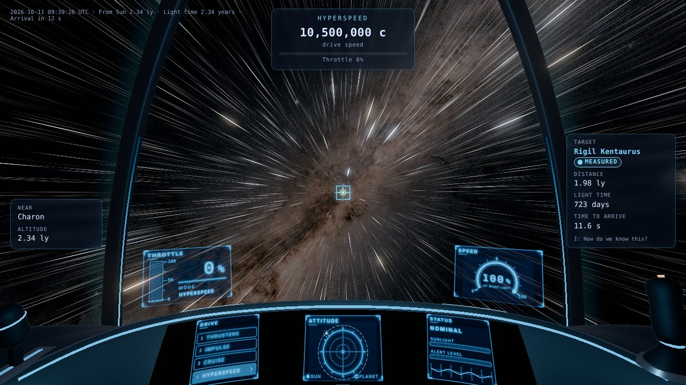
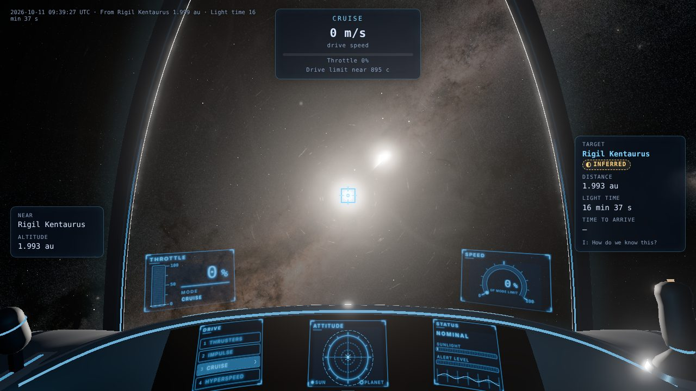
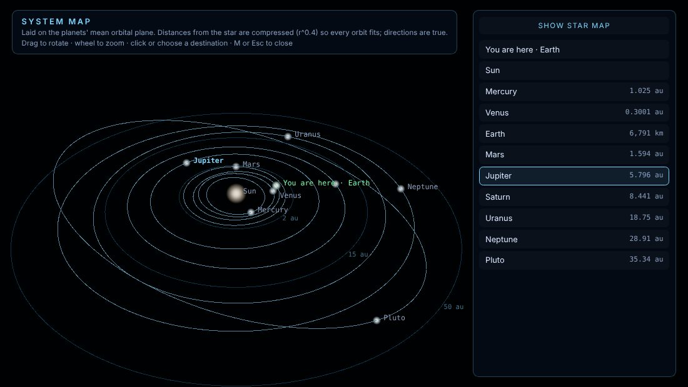
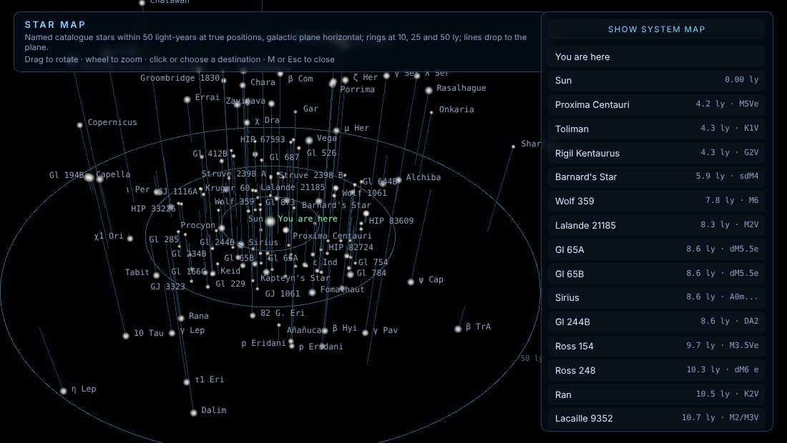

# M3 demo: known stars, hyperspeed and the map

**Goal (PRD 9a):** an offline-built star set with names, a hyperspeed jump between stars, and a map view.

**Run:** `npm run dev`, open `http://localhost:5173/`. Fly clear of Earth's gravity well (cruise, Space twice, then W), target a star (M opens the map; pick Proxima Centauri or Rigil Kentaurus), and press J.

## What works (each checked in Chromium)

- **Stars:** 109,400 HYG v4.1 stars within 1,000 pc, drawn on the GPU with apparent magnitude computed from the camera's position, so stars brighten as you approach them. Point-spread sprites; ESA Gaia EDR3 Milky Way behind them. 1,155 named stars can be targeted (D-029).
- **Hyperspeed** (`src/game/ship/hyperspeed.ts`): 3 s spool, then a transit of 20 + 6·log10(1 + ly) seconds with star streaks from the vanishing point (D-026). The HUD shows the real distance and the real light-travel time ("4.24 years") next to the fictional transit time. Refused inside a gravity well or when landed, with a message saying why.
- **Arrival:** the destination star becomes a lit body with radius, temperature and luminosity Inferred from its catalogue magnitude and colour, including a bolometric correction (D-027). α Centauri A: inferred 1.56 L☉ and 1.34 R☉; measured 1.52 L☉ and 1.22 R☉ (Kervella et al. 2017). The HUD footer reports the distance from that star, not from the Sun.
- **Map** (M): the system map lies on the planets' mean orbital plane with Kepler orbits and a compressed radial scale. The star map shows every named star within 50 ly at its true position, galactic plane horizontal. Labels are placed to avoid overlaps. The keyboard-accessible destination list sets the target (D-028).

## Captures

| | |
|---|---|
|  |  |
| Mid-jump to Rigil Kentaurus | Arrival: the star as a lit, Inferred body |
|  |  |
| System map | Star map, 50 ly |

## Tests

`tests/e2e/app.spec.ts`: the map lists destinations and selecting one sets the target; a jump to Proxima Centauri arrives outside the star and registers it as a lit body. `tests/unit/kepler.test.ts`, `tests/unit/stars.test.ts`.

## Known limits

- Inferred radii of M dwarfs come out about half the measured values, because B−V saturates for cool stars (Proxima Centauri: 0.075 vs 0.154 R☉). Measured overrides for named stars are planned.
- Only one visited star is kept as a body at a time; its planets (if known) arrive with M4.
- Unnamed stars are visible but cannot be targeted yet.
