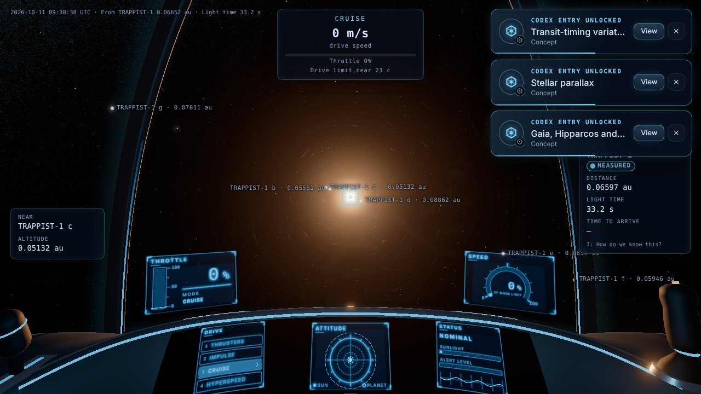
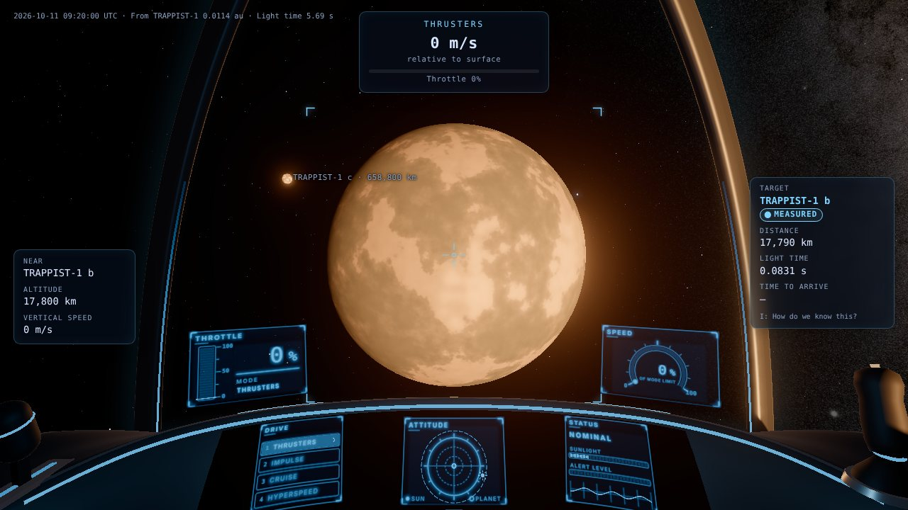
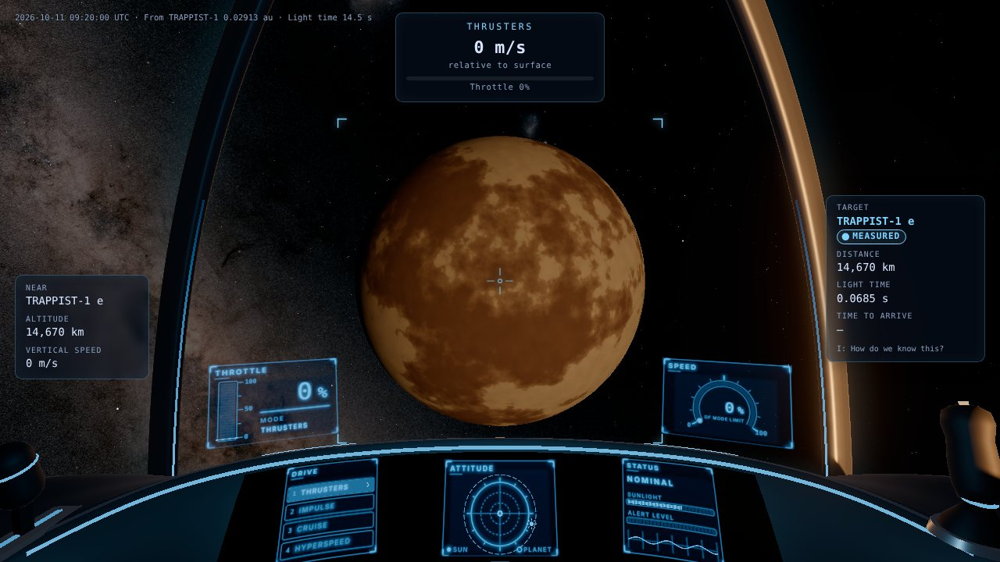
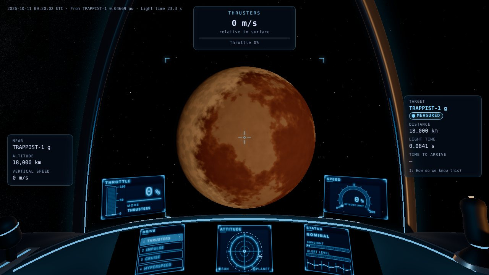

# M4 demo: TRAPPIST-1, a real exoplanet system

**Goal (PRD 9a):** one NASA Exoplanet Archive system built from archive values, with Inferred and Generated properties labelled, and a provenance panel with citations.

**Run:** `npm run dev`, open `http://localhost:5173/`. Fly clear of Earth's gravity well, open the map (M), pick TRAPPIST-1 in the star map, and press J. After arrival, Tab cycles through the seven planets; I opens "How do we know this?" for the target. `exo.html` is the data lab: every value with its tier, method and source.

## What works (each checked in Chromium)

- **Data** (`tools/pipeline/exoplanets.py`, `public/data/systems/trappist-1.json`, D-035, D-038):
  - **Sources:** the archive's default parameter set for all seven planets (Agol et al. 2021), cross-checked against Gaia DR3 and SIMBAD, with every value cited.
  - **Distance:** 12.47 pc (40.7 ly), 1/parallax from Gaia DR3, labelled Inferred. The archive still lists the Gaia DR2 value (12.43 pc); the note records it (D-040).
  - **Planet count:** the live confirmed count recorded with this build is 6,445 (archive, 2026-10-11).
  - **Build gate:** the pipeline writes nothing unless all its checks pass.
- **Provenance:**
  - Planet radius, mass, period, inclination and transit time are Measured, as published.
  - The star's temperature, radius, mass and age are Inferred: the source derives them from the luminosity, the transit density and an empirical mass relation (D-040). Its luminosity and spectral type are Measured.
  - Inferred values are labelled as such: equilibrium temperature, density, surface gravity, likely tidal locking ("likely, not observed"; Turbet et al. 2018, Vinson et al. 2019) and the mean ephemeris fitted to the Agol et al. 2024 transit forecasts.
  - Surfaces are Generated from a deterministic seed per planet, with the palette chosen from the inferred temperature (volcanic b, cratered c and d, mixed e, icy f, g and h).
  - No atmosphere is drawn, because none has been detected. JWST thermal emission disfavours thick CO₂ atmospheres on b and c.
- **In the game** (`src/world/exo/`):
  - **Orbits and spin:** planets move on circular orbits phased to the transits, at their measured inclinations. Each planet turns once per orbit, keeping one face toward the star.
  - **Precision:** positions within the system are computed in its own frame, so they stay precise to float64 at 12 pc.
  - **The star:** TRAPPIST-1 is a lit M8V star with its published radius and temperature (Inferred) and luminosity (Measured).
  - **Starlight colour:** worlds are lit with the star's colour (D-039), so they look orange.
  - **Glare:** it scales with the star's own luminosity, so the star no longer floods the view at arrival.
- **Codex:**
  - Arriving discovers the TRAPPIST-1 entry and unlocks the tidal-locking, habitable-zone and transit-timing concepts.
  - Every planet has an entry; "How do we know this?" lists each value with its tier and source.

## Captures

| | |
|---|---|
|  |  |
| Arrival, 0.066 au from the star; the planets are labelled points, and Codex toasts announce the discoveries | TRAPPIST-1 b (Generated volcanic surface), with c beyond |
|  |  |
| TRAPPIST-1 e (Generated mixed surface) | TRAPPIST-1 g (Generated icy surface) in orange starlight |

## Tests

- `tests/unit/exoLoader.test.ts`: the real JSON loads, and positions agree with the data module within 0.5°.
- `tests/unit/exoRuntime.test.ts`, `tests/unit/orbitFrame.test.ts`, `tests/unit/exoSystem.test.ts`: frames, phases, tidal locking, local-frame precision, and validation of counts, citations, ids, ordering and positivity.
- `tools/pipeline/test_exoplanets.py`: archive values and the mean ephemeris against committed fixtures, so the tests run on a fresh checkout.
- `tests/e2e/exo.spec.ts` (data lab: provenance marks and accessible names, layout, previews) and `tests/e2e/world.spec.ts` (per-star glare at a visited star).

## Known limits

- The orbit's orientation around the line of sight is a Generated angle, because transits cannot measure it (D-035).
- Positions are not corrected for the 40.5-year light travel time; the phases are a model reference.
- TRAPPIST-1 has no entry in the HYG catalogue, so before a visit it is not drawn in the sky. It is reached through the map.
