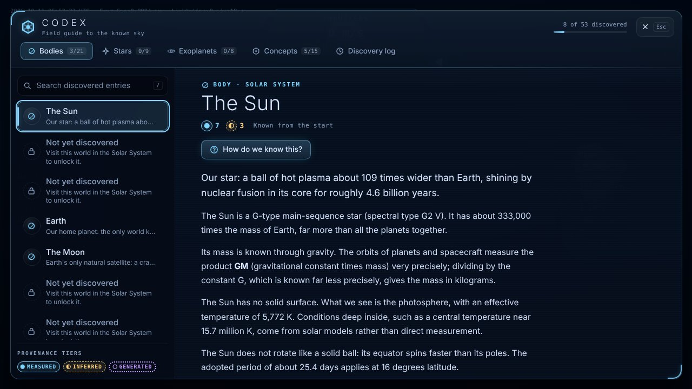
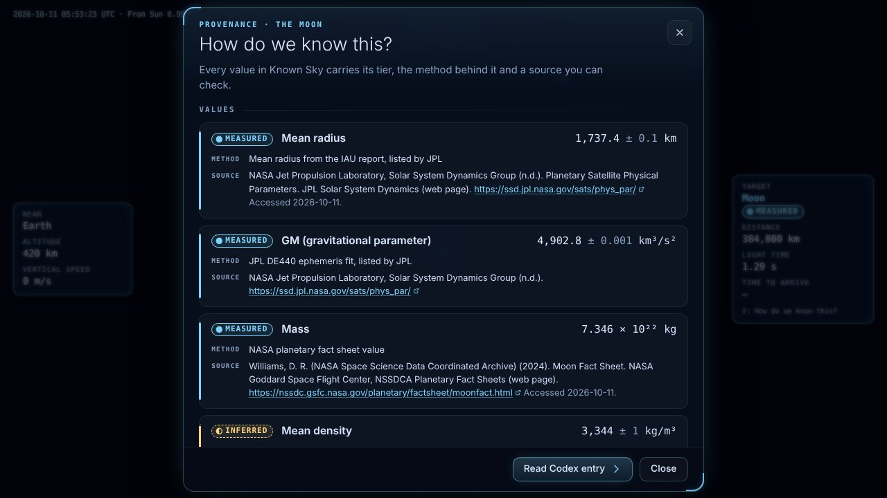

# M5 demo: Codex and provenance

**Goal (PRD 9a):** a Codex that fills in as you explore, and a "How do we know this?" panel that shows where every number comes from.

**Run:** `npm run dev`, open `http://localhost:5173/`. Press C to open the Codex and I to open "How do we know this?" for the current target (both keys can be remapped in Settings). `codex.html` shows the whole Codex at once for review.

## What works (each checked in Chromium)

- **Content** (`public/data/codex/en.json`): 53 entries (21 Solar System bodies, 9 stars, 8 exoplanets, 15 concepts) with 400 facts. 290 facts are Measured, 96 Inferred and 14 Generated. Each fact and claim cites one of 192 sources in `public/data/citations.json`. `tools/pipeline/codex_check.py` and `tests/unit/codex.test.ts` reject a Measured fact whose source is unverified (D-036).
- **Codex panel** (C): tabs for bodies, stars, exoplanets, concepts and the discovery log, plus search (/) and a progress count. Undiscovered entries show only a hint for how to unlock them. The key that opens the Codex also closes it, and follows the player's binding.
- **Discovery** (`src/game/codexDirector.ts`, D-037): visiting a body or arriving at a star discovers its entry, and concepts unlock the first time the game shows what they explain. Examples: targeting a star unlocks parallax; arriving at TRAPPIST-1 unlocks tidal locking, the habitable zone and transit-timing variations. A toast announces each discovery.
- **"How do we know this?"** (I): every value for the target, with its tier badge, the method behind it and its source, linked. It opens for any target with an entry, even before discovery: provenance is never locked.
- **Provenance in the HUD:** the target panel shows the target's tier badge (Measured, Inferred or Generated). The badges differ in shape and fill as well as colour, so they remain readable in colourblind modes.

## Captures

| | |
|---|---|
|  |  |
| The Codex at the start of a game: 8 of 53 entries known | "How do we know this?" for the Moon, opened with I |

## Tests

- `tests/e2e/app.spec.ts`, "Codex opens with C, explains the target with I, and unlocks on arrival": it opens and closes both dialogs with the keyboard. It checks that a game key works right after the Codex closes (a closed dialog used to swallow keys), and that arriving at Proxima Centauri discovers its entry and shows a toast.
- `tests/e2e/codexdata.spec.ts`: every entry renders all its facts and claims with resolved, numbered sources.
- `tests/unit/codex.test.ts` (content rules) and `tests/unit/codexStore.test.ts` (unlock, persistence, search).

## Known limits

- English only. All text goes through `t()` and locale files, so it can be translated.
- Discoveries are stored in the browser (`localStorage`). Clearing site data resets them.
- Concept unlocks depend on targeting or visiting. No scanner instrument exists yet.
