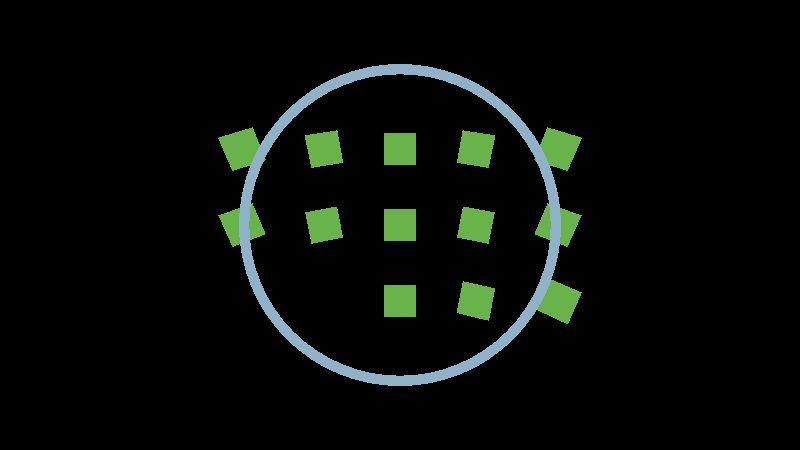
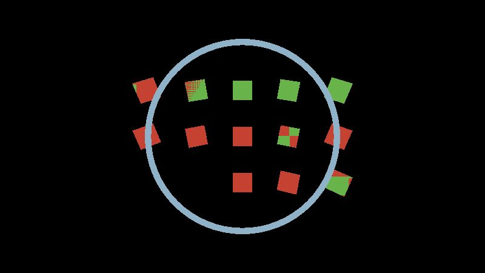
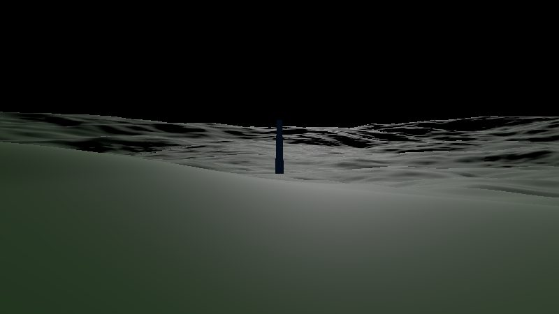

# M0 Spike: Rendering 1 m to 1e12 m in the browser

**Result: pass.** three.js r186 `WebGPURenderer` renders a scene spanning 1 m to 3e12 m without z-fighting or jitter on both the WebGPU and WebGL2 backends. The approach: camera-relative rendering + floating origin + depth partitioning (baseline), with reversed-Z as an optimization on WebGPU. No engine change and no fallback-ladder cut were needed.

Demo: `spike.html` (deployed build, and `npm run dev` → http://localhost:5173/spike.html). URL options: `?backend=webgpu|webgl2&depth=reversed|partitioned|naive&origin=relative|absolute`. Keys 1–5 switch views (plates, surface, orbit, far, jitter); drag to look, WASD/RF to move (speed scales with altitude).

## What the spike contains

- An Earth-radius (6.371e6 m) planet rendered as a cube-sphere quadtree. Chunks are built in Web Workers with deterministic procedural heights. LOD is driven by screen-space geometric error, refined down to level 18.
- A 1 m cube at 3 m, a 100 m tower at 500 m, a Jupiter-sized sphere at 1e11 m and a Sun-sized sphere at 1e12 m.
- **13 plate pairs**, one per decade from 3 m to 3e12 m. A green plate sits in front of a red plate, separated by 0.1 % of the distance. Any red pixel is z-fighting.
- **A jitter probe**: the camera is parked 1e12 m from the origin, with a 1 m marker 10 m ahead.
- **A cockpit-scale object** at 0.3 m, rendered in its own cockpit pass.

## Automated verification (`npm run e2e`, `tests/e2e/spike.spec.ts`)

All 8 tests pass in Chromium 141 (SwiftShader, no GPU):

| Test | Result |
|---|---|
| No z-fighting 3 m–3e12 m, WebGPU + reversed-Z | pass (0 red samples, all 13 decades visible) |
| No z-fighting, WebGPU + partitioned | pass |
| No z-fighting, WebGL2 + partitioned | pass |
| WebGL2 with reversed-Z requested degrades to partitioned and passes | pass |
| **Control:** naive single depth range (near 0.1, far 1e13) z-fights | pass (≥3 decades show red, so the test can detect the failure) |
| No jitter at 1e12 m with 1 mm camera steps, WebGPU | pass |
| No jitter at 1e12 m, WebGL2 | pass |
| **Control:** absolute world coordinates lose the marker at 1e12 m | pass (float32 rounding at 1e12 m is 65,536 m) |

Unit tests (`npm test`) cover the partition planner, float64 precision, time scales, deterministic hashing and noise, cube-sphere edge sharing and bit-identical chunk builds.

 
 

## What worked

1. **Camera-relative rendering, every frame.** The camera stays at the render origin. Each top-level object's `position` is written as (world − camera), computed in float64 on the CPU. Terrain chunks sit at float64 anchors inside a body group. three.js composes `matrixWorld` in float64 JavaScript, so the GPU only ever receives small translations. Nothing in the scene graph is rebuilt or reparented to rebase.
2. **Depth partitioning** (`src/render/depth/partition.ts`). Visible objects contribute view-space depth intervals. Overlapping intervals merge, and a group deeper than far/near = 2000 is split geometrically. Partitions render far to near with the depth buffer cleared between them. The plate scene uses 11 partitions; a typical surface view uses 2–3.
3. **Reversed-Z on WebGPU** collapses the world to one pass with ~1.2e-7 relative depth precision at every distance.
4. **Geometric-error LOD.** Each chunk measures its own deviation from the true surface at quad centres. Nodes split only when that error exceeds 1.5 px. This cut a ground-level view from 1.8 M to ~0.37 M triangles versus a screen-space quad-size metric.

## What did not work, and fixes

| Problem | Cause | Fix |
|---|---|---|
| WebGPU threw at the first render on Chromium 141 | three r186 always sets `swizzle: 'rgba'` (new spec string form) on texture views; Chromium ≤141 expects the old dictionary type | `render/compat.ts`: if the browser rejects the string form, strip the identity swizzle (a semantic no-op) |
| three's `getFallback` did not catch it | It only covers init failures | `render/bootstrap.ts` renders a probe frame and reads a pixel back after init; any error recreates the renderer on WebGL2 |
| WebGL2 + reversed-Z renders black on screen | three r186 renders correctly into render targets, but the final `RenderPipeline` pass to the canvas comes out black with reversed depth | WebGL2 always runs the partitioned baseline (`effectiveDepthMode`). Reversed-Z stays WebGPU-only |
| Off-axis objects clipped in partitioned mode | Intervals used Euclidean distance; clip planes act on view-space depth | Intervals use view-space depth; custom Euclidean near bounds are scaled by cos(half-diagonal FOV) |
| 43,000 chunk requests at ground level | Unbuilt nodes used ±relief bounds, so everything within 3 km split to max level | Coarse-to-fine refinement (split only when the node and all four children are built), a pending-request cap and cancellation of stale queued builds |
| Distant mountains briefly hidden while loading | A coarse parent chunk occludes finer terrain until its children arrive | Acceptable transient; geomorphing is a polish item |
| WebGPU canvas screenshots are black in headless Chromium | Compositor capture limitation | Tests capture in-page (`toDataURL` immediately after a render) |

## three.js version constraints

- Pin **three 0.186.1** exactly. Keep the swizzle shim and probe-frame fallback until older Chromium builds age out.
- WebGL2 backend: no reversed depth with `RenderPipeline` output (r186). Partitioned depth works.
- By default r186 computes model-view **on the GPU in float32** (`cameraViewMatrix * modelWorldMatrix`). That is exactly why camera-relative positions are mandatory: the naive control demonstrates the failure. (`renderer.highPrecision` exists, but it is not compatible with instancing, and camera-relative rendering makes it unnecessary.)
- WebGPU readback in headless Chromium needs `--enable-features=Vulkan --use-vulkan=swiftshader --disable-vulkan-surface` (in `playwright.config.ts`).

## Performance notes (not representative of real hardware)

This environment has no GPU; everything is rasterized on the CPU by SwiftShader. Frame times here (70–1500 ms) say nothing about a laptop GPU. Draw calls and triangles are meaningful.

| View | Draw calls | Triangles | Partitions |
|---|---|---|---|
| Plates (WebGPU) | ~100 | ~160 k | 1 (reversed) / 11 (partitioned) |
| Surface, 3 m altitude | ~160 | ~370 k | 1 / 2–3 |
| Orbit, 400 km | ~25 | ~53 k | 1 |

Both are within the budgets in `TECH_PLAN.md` (≤ 300 draws WebGL2, ≤ 1.5 M triangles). The real 60 fps check is the owner benchmark (`?bench=1`, M7).

## Recommendation

Proceed with the planned architecture. Default to WebGPU + reversed-Z, fall back to WebGL2 + partitioned automatically, and keep both covered by e2e tests.
